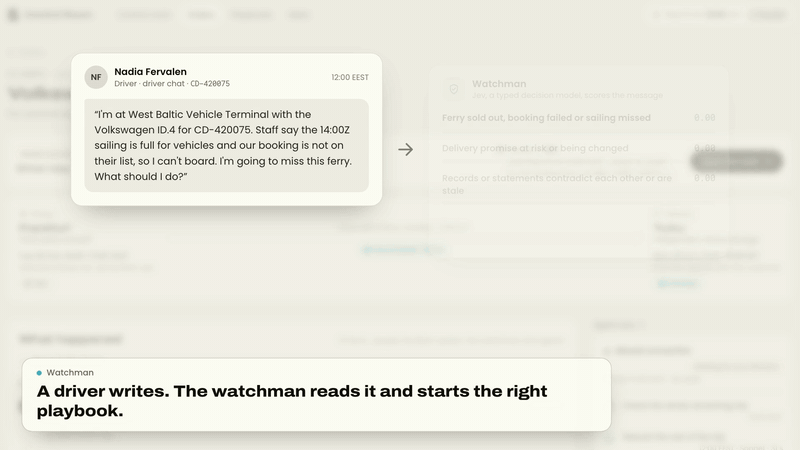
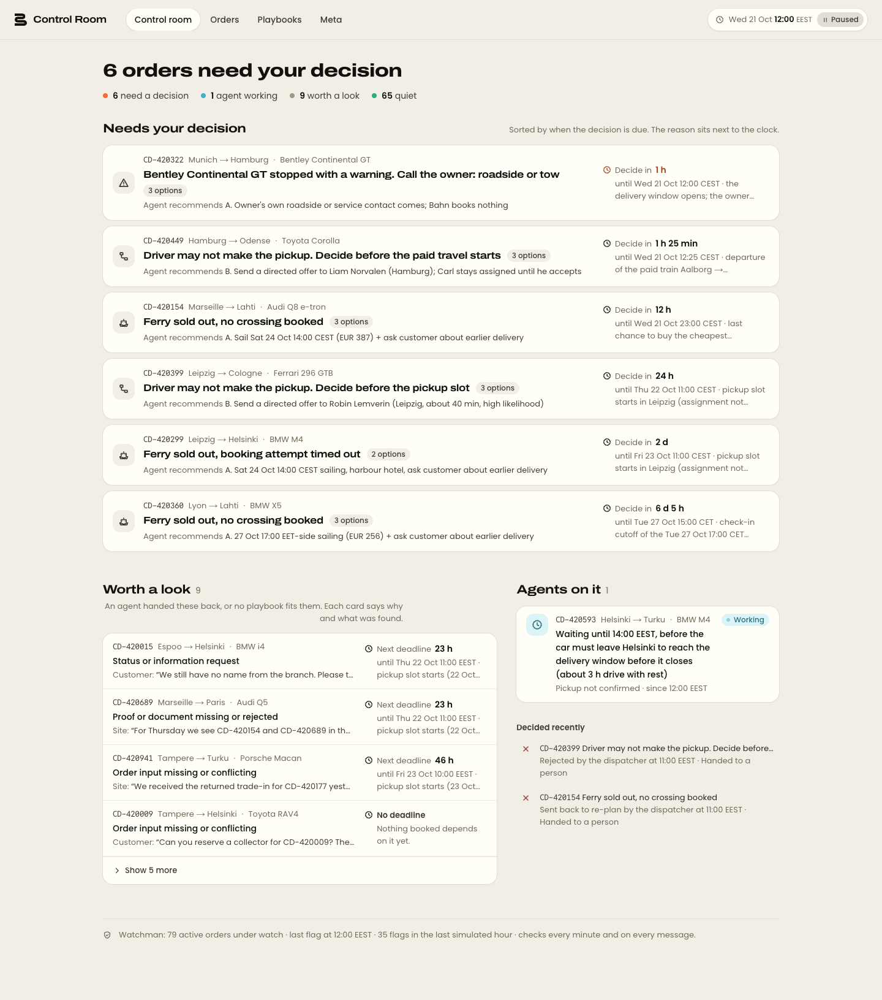
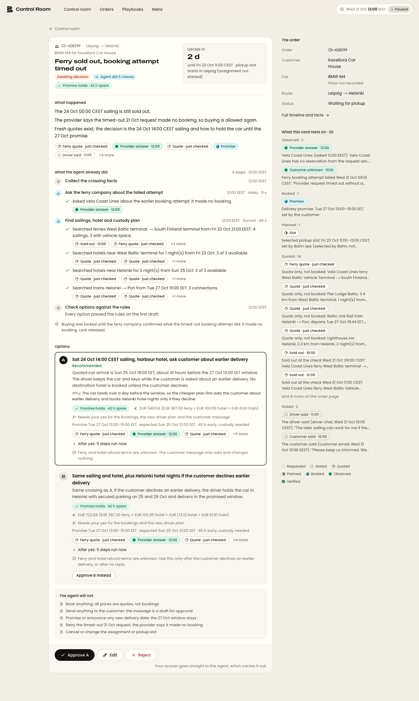
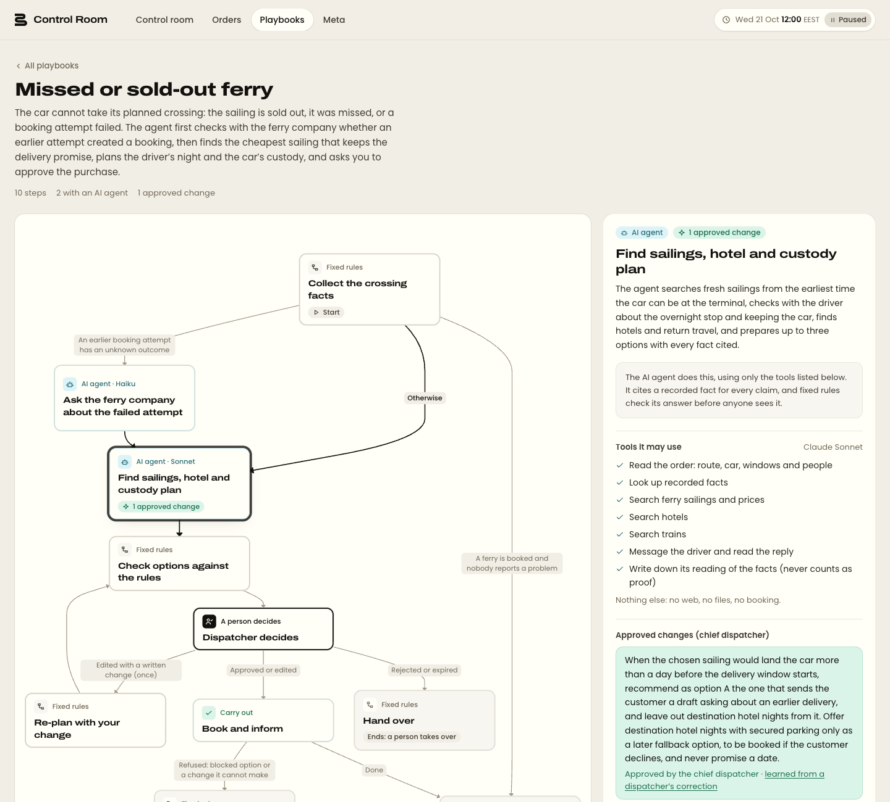
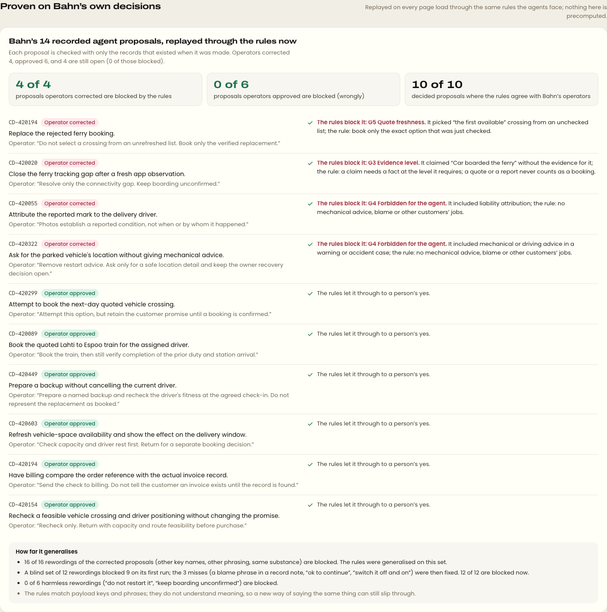

# Bahn Control Room

Agents prepare the decision. People make it.

[](public/brand/trailer/trailer-720p.mp4)

[Trailer, 86 s](public/brand/trailer/trailer-720p.mp4) ([1080p](public/brand/trailer/trailer.mp4)) · short clips:
[control room](public/brand/trailer/control-room-story.mp4) ·
[playbooks](public/brand/trailer/playbooks-story.mp4) ·
[meta-system](public/brand/trailer/meta-story.mp4). Recorded from the running app; bookings in it are simulated.

A control room for Bahn's car-delivery operations, built for the Prompt Operations Hackathon (Espoo, 24–25 Oct 2026).
A watchman reads every message and clock tick, a closed set of playbooks sends real agents (Claude Code, with our tools
only) to do the legwork, and a person sees only the orders that need them: one decision card each, sorted by the time
left to decide, every fact with its source. Edits and rejections become rule changes that a chief dispatcher approves.

| Only what needs a person, sorted by time left                   | One decision card, every fact with its source                    |
| --------------------------------------------------------------- | ---------------------------------------------------------------- |
|          |  |
| **Every playbook as a diagram, with what it learned**           | **The rules, replayed live on Bahn's own 14 decisions**          |
|  |      |

- How it works: [`ARCHITECTURE.md`](ARCHITECTURE.md)
- Demo script and live runbook: [`DEMO.md`](DEMO.md)
- How it was built overnight by a team of coding agents, decision by decision: [`NIGHT_SHIFT.md`](NIGHT_SHIFT.md)
- The research behind the playbooks and rules: [`research/`](research/decision-tree/README.md)

## Run it (macOS)

You need: Docker, Node 24 + pnpm, the Claude Code CLI, a Trigger.dev project and an OpenRouter key. The Supabase and
Trigger.dev CLIs come with the dev dependencies.

```bash
brew install --cask docker                    # local Supabase runs in Docker; start Docker Desktop once
brew install fnm pnpm && fnm install          # Node 24 from .node-version, pnpm 11
npm install -g @anthropic-ai/claude-code      # agents run `claude -p` headless; run `claude` once and /login (or set ANTHROPIC_API_KEY)
```

Keys, into `.env.local` (`.env.example` lists them):

- **Trigger.dev**: a project at [cloud.trigger.dev](https://cloud.trigger.dev) (free tier). The dev secret key
  (`tr_dev_…`), the project ref (`proj_…`) and a personal access token (`tr_pat_…`). Tasks run on your machine through
  `trigger dev`; nothing is deployed.
- **OpenRouter**: an API key for Jev, the decision model behind the watchman (about $0.00002 a call).

```bash
pnpm install                       # dependencies + Prisma client
cp .env.example .env.local         # fill in the four keys
pnpm exec supabase start           # local Postgres on :55322 (first run pulls images)
pnpm prisma:migrate:deploy:local   # creates the bahn (Bahn's DB) and control (ours) schemas
pnpm seed:bahn:local               # loads the challenge dataset into bahn.* (4,366 rows)
pnpm facts:sync:local              # turns Bahn's records into facts with evidence levels
pnpm dev:stack                     # Supabase + Next.js on :3001 + trigger dev; Ctrl+C stops all three
```

In a second terminal, once `trigger dev` says "Local worker ready":

```bash
pnpm demo:reset                    # clean slate; the simulated clock paused at 21 Oct 09:00 UTC
pnpm demo:prime                    # watchman → router → playbooks until the demo cards are open (~2 min, ~$0.80 of agent runs)
open http://localhost:3001
```

Then try:

```bash
pnpm sim:scenario S1               # a driver writes the ferry is full → a new decision card in about a minute
pnpm sim:scenario S2               # a red warning light → the agent checks the driver is safe, quotes tow services
pnpm sim:scenario S4               # a message no playbook covers → a triage card with the facts gathered
pnpm sim:scenario S6               # a missed sailing with a hotel and return train booked after it → the card rebooks the rest of the trip
pnpm test                          # unit tests, no DB or network
```

In the app: approve a card and watch the run book (simulated) and close; reject one with a note to see a hand-over
card and a proposed rule appear on `/meta`; set the clock (top right) to 120× to wake the pickup-unconfirmed wait.
Every script is described in [`ARCHITECTURE.md`](ARCHITECTURE.md#all-scripts).
